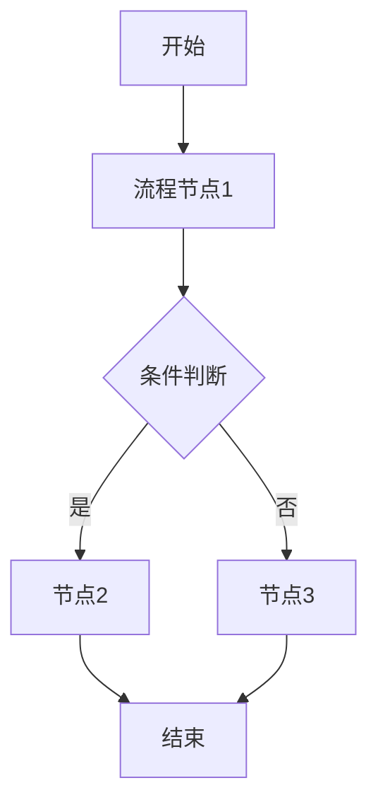
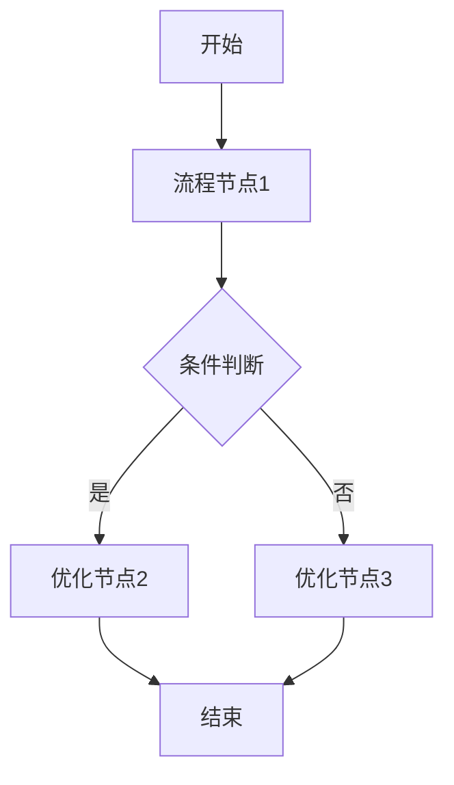

# 需求分析模板

## 一、需求背景分析

描述需求的来源、现状问题或机会。明确为什么要做这个需求。

**分析要点**：
- 当前业务痛点是什么？
- 受影响的销售角色/客户有哪些？
- 不做这个需求会有什么影响？

---

## 二、需求目标确认

基于需求背景，确认本次需求的核心目标和期望成果。

**目标特征**：
- 具体可衡量
- 有明确的价值交付
- 可落地执行

---

## 三、业务流程分析

使用 Mermaid 语法绘制当前业务流程（现状）和目标流程（改善后）。

### 3.1 当前流程（现状）

### 3.2 目标流程（改善后）

---

## 四、功能拆解清单

按结构化表格表达：

| 终端/模块 | 功能 | 功能描述 | 优先级 |
|-----------|------|----------|----------|
| AI销售秘书 | 客户分析 | 对客户进行画像分析和商机潜力评估 | Must |
| AI销售秘书 | 话术优化 | 根据销售场景生成话术建议 | Must |
| AI销售秘书 | 方案撰写 | 快速生成物流方案、合作方案等文档 | Should |
| AI销售秘书 | 销售陪练 | 模拟客户对话，提供话术评分和反馈 | Should |
| AI销售秘书 | 智能讲解 | AI驱动的产品/平台介绍讲解 | Could |
| 客户笔记 | 笔记管理 | 记录和管理客户关键信息 | Must |
| 文件管理 | 文件管理 | 管理AI生成的报告、方案等文件 | Should |

**终端/模块说明**：
- AI销售秘书：对话式 AI 助手的核心功能
- 客户笔记：客户信息记录和档案管理
- 文件管理：AI 生成文档的管理和检索

**优先级**：Must（必须有）/ Should（应该有）/ Could（可以有）/ Won't（不会有）

---

## 五、待确认事项

列出需求中尚未确认、需要与干系人进一步沟通的内容。

| 序号 | 待确认事项 | 状态 | 负责人 | 截止日期 |
|------|------------|------|--------|----------|
| 1 | AI 模型选型和能力边界 | 待确认 | - | - |
| 2 | 客户数据的来源和同步方式 | 待确认 | - | - |

**确认原则**：
- 所有 Must 级别功能必须在 PRD 撰写前完成确认
- 未确认事项不得在 PRD 中编造，必须标注"待确认"
