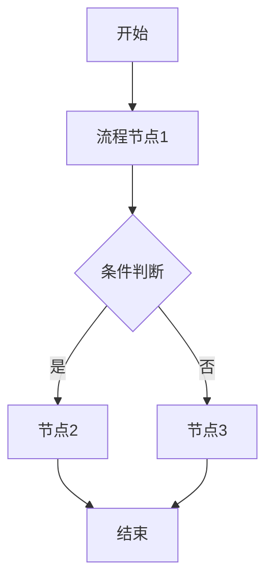
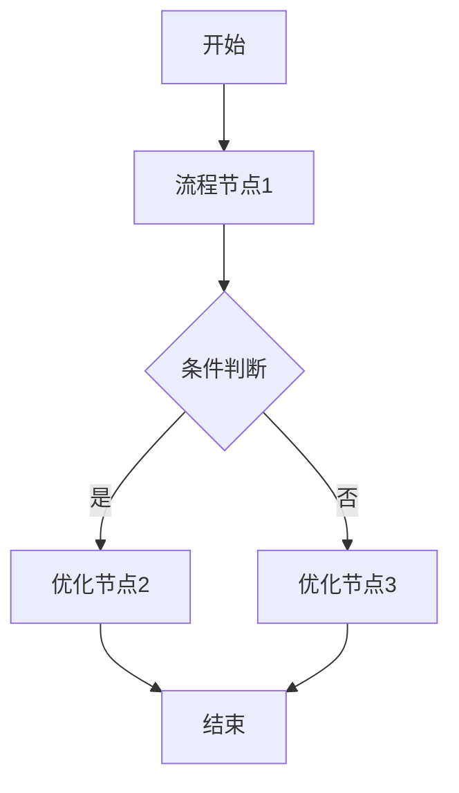

# 会议纪要需求分析模板

> 本模板用于从会议纪要中提取需求信息，并生成标准需求分析文档。

## 使用说明

当用户提供会议纪要（文字记录、语音转写文本、会议笔记等）时，按以下步骤处理：

1. **解析会议纪要**：识别会议中的需求讨论内容
2. **提取需求要素**：从纪要中提取背景、目标、流程、功能等关键信息
3. **识别信息缺口**：标注纪要中未明确但需求分析必需的字段
4. **生成需求分析文档**：按五段式结构输出（见下方模板）
5. **保存文件**：保存到 `prd/需求分析/` 目录，文件名格式 `YYYY-MM-DD_会议主题_需求分析.md`

---

## 会议纪要解析规则

### 需求信息提取清单

| 需求要素 | 提取说明 | 缺失处理 |
|----------|----------|----------|
| 需求来源 | 谁提出的、什么会议、什么时间 | 标注"待确认" |
| 业务痛点 | 当前什么问题需要解决 | 从上下文推断，标注依据 |
| 期望目标 | 希望达成什么结果 | 如未提及，主动询问用户 |
| 涉及角色 | 哪些用户/角色会受影响 | 列出已知角色，其余标注"待确认" |
| 业务流程 | 当前流程和目标流程 | 根据讨论内容推导，用 Mermaid 绘制 |
| 功能点 | 讨论到的具体功能需求 | 逐条提取，标注优先级 |
| 约束条件 | 时间、资源、技术限制 | 如有则记录 |
| 干系人 | 决策者、执行者、使用者 | 从纪要中提取 |

### 信息完整性检查

处理会议纪要后，必须检查以下字段是否完整：

- [ ] 需求背景是否清晰（为什么做）
- [ ] 目标是否明确（做什么、得到什么）
- [ ] 业务流程是否可描述（怎么做）
- [ ] 功能清单是否可拆解（拆成什么）
- [ ] 待确认事项是否已列出（还有什么不确定）

**如有任何一项无法从纪要中提取，必须在文档中标注并主动询问用户补充。**

---

## 五段式需求分析文档模板

### 一、需求背景分析

> 从会议纪要中提取的需求来源和背景说明。

**会议信息**：
- 会议主题：【从纪要提取】
- 会议时间：【从纪要提取，如未提及则标注"待确认"】
- 参会人员：【从纪要提取，如未提及则标注"待确认"】

**需求来源**：
- 提出人：【从纪要提取】
- 触发事件：【什么事件或问题导致了这个需求】

**业务现状**：
- 当前痛点：【从纪要中提取的业务问题】
- 受影响角色：【列出受影响的用户/角色】
- 不做的影响：【如果不解决这个问题的后果】

---

### 二、需求目标确认

**核心目标**：
- 【从纪要中提取的主要目标】

**期望成果**：
- 【从纪要中提取的期望结果或指标】

**目标验证**：
- 如何判断目标达成：【可衡量的标准】

---

### 三、业务流程分析

使用 Mermaid 语法绘制当前业务流程（现状）和目标流程（改善后）。

#### 3.1 当前流程（现状）



#### 3.2 目标流程（改善后）



---

### 四、功能拆解清单

| 终端/模块 | 功能 | 功能描述 | 优先级 | 来源 |
|-----------|------|----------|----------|------|
| 【模块名】 | 【功能名】 | 【从纪要中提取的描述】 | Must/Should/Could | 【会议纪要第X段/用户补充】 |
| 【】 | 【】 | 【】 | 【】 | 【】 |

**优先级**：Must（必须有）/ Should（应该有）/ Could（可以有）/ Won't（不会有）

**优先级判定依据**：
- Must：会议中明确必须实现、或缺失则需求无法成立的功能
- Should：会议中强烈建议、但不影响核心流程的功能
- Could：会议中提到但非本次必须的增强功能
- Won't：会议中明确排除或延后的功能

---

### 五、待确认事项

| 序号 | 待确认事项 | 类型 | 状态 | 负责人 | 截止日期 |
|------|------------|------|------|--------|----------|
| 1 | 【从纪要中标注的未决事项】 | 需求/技术/资源 | 待确认 | - | - |
| 2 | 【纪要中未提及但必需的信息】 | 需求/技术/资源 | 待确认 | - | - |

**待确认类型说明**：
- 需求类：功能细节、业务规则、用户角色等
- 技术类：技术方案、数据接口、系统兼容性等
- 资源类：人员、时间、预算等

**确认原则**：
- 所有 Must 级别功能必须在 PRD 撰写前完成确认
- 未确认事项不得在 PRD 中编造，必须标注"待确认"
- 主动询问用户补充纪要中缺失的关键信息

---

## 会议纪要处理示例

**用户输入**：
```
会议纪要：
2026年8月30日，产品团队讨论了客户管理系统的改进需求。

张三（产品总监）：现在销售同事在跟进客户的时候，信息都散落在各个地方，微信聊天记录、邮件、电话记录都要手动整理，效率很低。

李四（销售主管）：对，我们希望能有个统一的地方记录客户的所有互动，而且最好能自动从邮件里提取关键信息。

王五（技术负责人）：技术上可以实现邮件解析，但需要确认邮件系统的API接口。另外，数据权限怎么划分？

张三：这个我们后面再确认。先保证基础的客户信息管理能做出来，优先级最高。

预计下个月底要出第一个版本。
```

**输出文档结构**：
- 需求背景：客户信息散落、手动整理效率低
- 需求目标：统一客户信息管理，提升跟进效率
- 业务流程：当前手动整理 → 目标系统自动聚合
- 功能拆解：客户信息管理(Must)、邮件自动解析(Should)、数据权限管理(待确认)
- 待确认事项：邮件系统API、数据权限规则、具体上线时间
